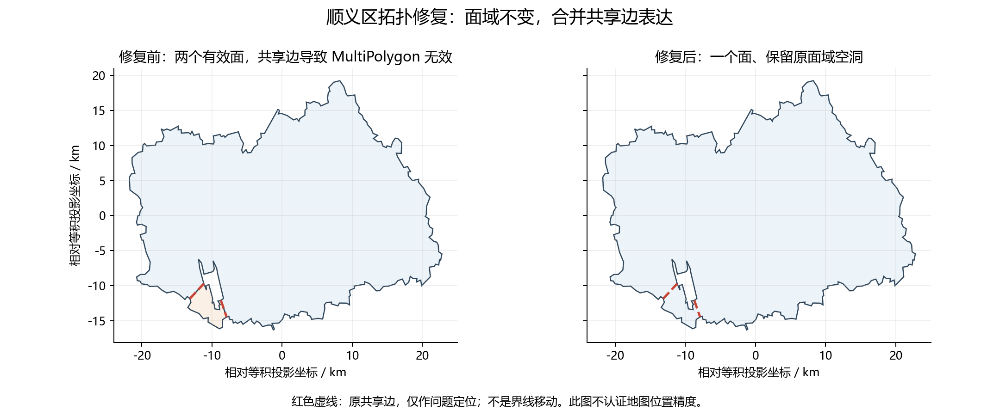

# 顺义区几何修复与计算影响报告

日期：2026年10月14日。仓库基线：`0daab15d8813a4c52e88b708fd307b151e1d9b73`。

**结论：顺义区可以在本次固定边界、现有计算口径下恢复参与区域计算。** 源边界和生成边界均已修复并通过几何有效性检查，全部原面域保留，O1280权重重新生成且覆盖检查通过。本月ERA5诊断没有发现由本次拓扑修复引起的实质数值变化。此结论不等于地图位置精度、历史代表性或科研适用性已全面通过。

## 1. 执行情况和版本

| 任务 | 状态 | 证据 |
|---|---|---|
| 当前版本检查与问题复现 | 完成 | 源与输出均复现同一无效位置；新增测试先失败后通过 |
| 层级关系与最小修复 | 完成 | 110113源要素合并两个有效面；构建入口增加无效几何拒绝检查 |
| 方法比较与区域保持 | 完成 | 四种方法面域一致，无丢失、无碎片，保留原面域空洞 |
| 几何量化与权重重建 | 完成 | 顺义、北京urban重算，43个其余单元面域一致；完整45单元构建验证 |
| T、HI、AT敏感性 | 完成 | 相同ERA5样本、计算日和8个平移情景；逐小时/日明细已保存 |
| 回归与独立复核 | 完成 | 61项测试通过，含5项新增；独立只读复核无重大问题 |

通过Git直接克隆用户仓库检查当前版本，当前HEAD与此前核查记录一致。工作在独立副本 `work/repository` 的本地 `fix/shunyi-geometry` 分支中完成，首次边界验证阶段未提交或推送；后续按用户追加授权提交修复分支并同步正式预报，详见《正式预报更新说明》。未合并或部署。交付的 `修复后仓库` 是文件快照，不含Git内部目录。

ERA5只读打开。读前、读后SHA256相同，修改时间不变，且SHA256与已有证据包记录一致：

`ce96e9a97e78d9488323208d12dce20eebf4c6ade2709f9d54f29f8ebfba5e2b`

## 2. 数据链与修复所在层

`data/boundary_sources/110000.json` → `scripts/build_spatial.py::build_units` → 区级/联合区域几何 → `calculate_points` → `data/static/units/*_points.csv` → `update_units.py::load_city/weighted_hourly` → 天气与热指标。

- 顺义110113属于北京OTHER，是独立非urban研究单元，同时纳入16区的 `beijing_urban` 并集。
- `beijing_core`由东城、西城、朝阳、丰台、石景山、海淀构成，不纳入顺义。其既有冻结权重按原构建逻辑保留。
- O1280权重是局部等积投影中格点中心的Voronoi单元与边界的相交面积，再归一化；它不是本次ERA5的0.1°格网权重。
- 修复必须落在源边界。只修输出会在下次生成时重新产生问题。此次不加入运行时自动修复，而是修正固定源文件，构建时遇到无效或空几何便明确拒绝并指出区代码。
- HI、AT函数及阈值未改。源文件继续采用原 `gb18030` 编码和MultiPolygon容器；所有属性、其他15区要素均逐项保持原解析内容。

## 3. 根因及修复方法

复现错误：`Self-intersection[116.597880097152 40.0519039932611]`。原生成顺义GeoJSON同样无效。

原顺义MultiPolygon有两个Polygon，两个组成面各自有效，且相交面积为0；但共用两段边，总长约 **5426.194米**。共享线段不符合有效MultiPolygon的组成面相接规则，因而整体被报告为自相交。本轮处理的是这个拓扑表达问题，不是猜测某个顶点应向哪个方向移动。

| 方法 | 面域结果 | 丢失面积/碎片 | 处理判断 |
|---|---|---|---|
| 两个原有效面 `unary_union` | 一个Polygon、一个空洞 | 两原面的丢失面积均为0，无面碎片 | 采用；根因明确，直接保留有效面并集 |
| `buffer(0)` | 与并集相同 | 本例未丢失面积、无面碎片 | 仅比较；不能把本例结果推广到任意自交 |
| `make_valid` linework | Polygon及共享边MultiLineString | 面域相同；额外线段面积为0 | 完整结果另存；仅取面域用于比较，不删除任何面区域 |
| `make_valid(method='structure', keep_collapsed=False)` | 与并集相同 | 本例未丢失面积、无面碎片 | 仅比较 |

持久化源几何为包含上述一个Polygon的MultiPolygon。未删小面、未选“最大面”、未移动顶点、未简化、未填洞。原小面约17.111967 km²，完整保留。原两个面各自无内环，但它们的组合围出的未覆盖面域在有效并集里表达为一个内环；这是保留原面域空洞，不是新挖去一块区域。

原始文件、修复文件、所有候选几何和共享线均保存在证据包 `before/`、`after/`、`candidates/`，逐文件SHA256见 `geometry_weights_audit.json`。

## 4. 几何量化及位置解释

本节面积采用与已有敏感性诊断一致的Albers等积投影：`lat_1=25, lat_2=47, lat_0=0, lon_0=105, datum=WGS84`。

| 检查量 | 结果 |
|---|---:|
| 原两个有效面面积 | 992.227426381 + 17.111966994 km² |
| 修复后面积 | 1009.339393375 km² |
| 修复面积减原有效面面积之和 | −2.384×10⁻⁷ m²（浮点舍入） |
| 四种候选与原有效面并集的对称差 | 0 m² |
| 任一原有效面落在修复面域之外的面积 | 0 m² |
| 候选方法间边界Hausdorff距离 | 0 m |
| 新边界不在原边线集合中的长度 | 0 m |
| 原顶点未保留数量 | 0 |
| 原所有环与修复所有环的加密Hausdorff距离 | 约1387.218 m |

最后一行采用 `densify=.001` 采样，是环集合距离的近似量，包含原内部共享边被移除的影响；**不能解释成外界线移动了1387米**。不加密的离散顶点Hausdorff会返回0，遗漏共享边中间的位置变化，因此没有用该0值宣称所有环都毫无改变。新边界全部由原边构成，面域对称差为0，外部区域范围和原空洞均保留。这里只证明几何拓扑与原输入面域的一致性，没有独立真实界线控制点的位置精度验证。

原无效MultiPolygon无法提供可信的直接相交/对称差基线，因此原无效对象与修复对象的直接叠加比较记录为不可用；没有以报错或偶然返回的数值伪造修复前结果。依据两个有效、无面积重叠的原面，可独立计算其并集及分别相交面积之和，作为面域保持和科研数值比较的参考。

## 5. O1280格点与联合区域

按仓库原函数重建顺义和北京urban，坐标集合以真实下游10位小数键比较。未以CSV行号或point_id代替格点坐标匹配。

| 检查量 | 顺义 | 北京urban |
|---|---:|---:|
| 原/新格点数 | 21 / 21 | 246 / 246 |
| 格点键集合变化 | 0 | 0 |
| 新权重最小值 | 0.001622440049 | 0.000004255260 |
| 新权重和 | 0.9999999999999998 | 1.0 |
| 新几何LAEA面积 km² | 1009.339434353 | 16407.336601084 |
| 相交覆盖面积 km² | 1009.339434353 | 16407.336601084 |
| 覆盖误差 km² | 1.14×10⁻¹³ | 1.46×10⁻¹¹ |
| 与原存储权重最大绝对差 | 3.14×10⁻¹⁴ | 1.85×10⁻¹⁵ |
| 权重总变差（绝对差和的一半） | 1.19×10⁻¹³ | 8.19×10⁻¹⁴ |

两个单元权重有限、严格为正、和在1e-12内为1；覆盖误差远低于仓库0.01 km²阈值。LAEA采用单元质心为中心，与本报告Albers面积略有不同（顺义约41 m²差异），这是投影及直线段表示的计算差别，不是边界修复丢失/增加区域。

北京urban原几何已经有效，本次重建后与其对称差0 m²、边界距离0 m，GeoJSON文件字节也一致；其CSV只出现浮点表示微差。其余43个单元的存储边界与重建几何面域逐一一致，均未改动这些单元的文件；北京core不受顺义修复影响。

另外在独立临时目录运行完整 `build_spatial.main()`：45个单元均生成成功、几何有效、与修复后仓库面域一致。权重归一检查使用1e-12；仅北京core依原脚本保留冻结CSV，和为0.9999999998000001，沿用仓库1e-6容差，不重新修改这一回归基线。

旧存储顺义权重可以作为“已存储权重”比对，但其存在并不能证明旧无效几何叠加流程普遍可靠。此次用有效源重建后确认结果与存储数值相符。

## 6. ERA5诊断口径与正式指标的区分

ERA5样本为用户指定 `era5_land_1991_06_jingjinji.nc`，720个UTC连续小时。沿用已有分析的固定UTC+8日分组，取索引 `16:712`，即1991年6月2日至30日29个完整计算日。固定UTC+8与1991年历史Asia/Shanghai夏令时分组不同；此次为保持既有口径没有改分组，不能把这些计算日解释成已核实的历史法定民用日。

- 0.1°格点中心周围±0.05°格网，投影后与面域求交；面积大于1 m²且整月T/RH/u/v联合有效的格点参与归一。所有情景保持同一整月有效支持。
- RH使用已有分析的固定水相Magnus近似，风速为 `hypot(u,v)`。样本336个格点小时RH略超过100%，最大100.0174065%，Td−T最大0.00268555℃；仅诊断中沿用此前截到100%的处理，ERA5文件未改。
- 先按面积权重得到逐小时区域T、RH、风速；HI调用仓库 `heat_index_c`；日AT调用原 `calculate_at`，输入为每日区域T/RH/风速均值。没有把逐格HI平均替代区域HI，也没有把逐小时AT平均替代仓库日AT。
- 顺义基准ERA5格点为23个，面积覆盖1009.339393375 km²，有效支持覆盖率约1，误差约−1.07×10⁻⁶ m²。北京urban为226个；均不同于O1280点数，权重分目录保存。
- 顺义在仓库正式流水线有天气/T及日AT、两年龄组风险输出；顺义HI及HI日峰值/分类仅为本轮诊断。仓库urban分支正式生成HI。这里所有ERA5试算都是诊断结果，均没有写入仓库实时预报输出。

### 6.1 拓扑修复的数值影响

修复前参考通过“原两个有效面分别与每个格网相交，再合并面积”独立计算，不直接对无效MultiPolygon叠加。两个面无面积重叠，故此参考有明确面域意义。

| 比较 | 最大权重绝对差 | 最大T差 ℃ | 最大HI差 ℃ | 最大日AT差 ℃ | 分级变化 |
|---|---:|---:|---:|---:|---|
| 原有效面独立相交参考 vs 修复 | 4.37×10⁻¹⁶ | 7.11×10⁻¹⁵ | 1.71×10⁻¹³ | 7.11×10⁻¹⁵ | HI及两年龄AT均0 |
| 四种修复候选之间 | 0 | 0 | 0 | 0 | 均0 |
| 北京urban原有效几何 vs 修复重建 | 0 | 0 | 0 | 0 | 均0 |

因此本样本内拓扑修复的数值影响仅为浮点舍入，不存在可识别的实质区域计算变化。不能据此宣称已重算所有实时IFS预报或所有历史月份。仓库 `data/current`、`data/processed` 的预报结果没有被ERA5诊断覆盖；首次交付快照保留的是原提交预报；用户追加授权后，北京正式预报已使用修复后的静态边界和权重刷新，详见《正式预报更新说明》。

### 6.2 修复后顺义的平移敏感性

在上述Albers投影分别向东、西、南、北平移100米和500米，重新求交并归一。幅度是人为压力测试，不是位置误差置信区间，也不是修复前后的变化。

| 距离 | 方向 | 逐小时T最大差 ℃ | 逐小时HI最大差 ℃ | 日AT最大差 ℃ |
|---:|---|---:|---:|---:|
| 100 m | 东 | 0.012220 | 0.011945 | 0.002564 |
| 100 m | 西 | 0.012193 | 0.011920 | 0.002524 |
| 100 m | 北 | 0.013303 | 0.013039 | 0.005318 |
| 100 m | 南 | 0.013380 | 0.013106 | 0.005290 |
| 500 m | 东 | 0.060780 | 0.059414 | 0.012983 |
| 500 m | 西 | 0.060877 | 0.059512 | 0.012438 |
| 500 m | 北 | 0.066218 | 0.064933 | 0.026658 |
| 500 m | 南 | 0.067496 | 0.066085 | 0.026486 |

8个情景均无HI日最高分类和两年龄组日AT等级变化。逐情景格点变化、权重总变差、最差HI时刻和分支输入见 `sensitivity_results.json`；逐小时、日及每格权重CSV见 `era5_metrics/`、`era5_weights/`。没有将“8情景×29日”称为232个独立自然日。

为验证与此前口径衔接，重新计算此前北京urban向东100米情景：最大T差0.007635526698823725℃、最大HI差0.007622283995580403℃，与已有结果完全一致，HI日分类变化仍为0。

## 7. 验证、复核和可复现交付

- 几何有效性两项回归测试先实际失败，并复现同一位置；另外两个入口拒绝测试先暴露未拦截的GEOS异常，修复后通过。随后补充原两面/空洞保持测试。
- 最终仓库全套61项测试通过，含5项新增顺义测试；完整45单元构建及权重检查通过。完整日志保存在证据包。日志中Shapely 2.2对原仓库 `shapely.ops.transform` 有弃用提示，未做无关接口迁移。
- 几何审计与诊断脚本有面积、面域保持、源版本、有效支持、归一、有限值、输入文件未变及既有情景复算断言。重复运行后逐文件摘要核查保存于 `reproducibility_check.json`。
- 独立只读复核实际重跑5项顺义测试，检查真实下游10位坐标键及几何保持；未发现必须修复或应修复问题。该复核没有独立完整重跑全部ERA5、61项测试或45单元构建，也没有调用实时IFS接口，不能当成另一个独立全流程实验。

交付：`evidence/`含修复前后文件、候选、逐格/逐时/逐日明细、摘要与复现脚本；`修复后仓库/`为完整可检查文件快照；`顺义最小修复.patch`包含源、顺义产物、顺义及urban权重、7行构建检查和回归测试。详细运行顺序见 `复现说明.md`。全部文件另打包为 `顺义修复完整交付.zip`，不含ERA5样本。

## 8. 可以恢复什么，仍限制什么

可以恢复：顺义的有效面域叠加、O1280面积加权区域计算、同口径ERA5诊断，以及仓库支持的T/天气与日AT流程。本次无需删除顺义或删去小面。北京urban无需更改研究区组成，core及其他单元不需因本问题重新定义。

仍有限制：仅使用一个月ERA5样本，尚不能覆盖所有年份、热浪或HI/AT阈值附近情形；本轮保留原公式和既有湿度/固定UTC+8诊断口径，不做它们的全面科学认证；没有独立界址控制点或高精度参考图验证；未开展历史边界、海岸线、水域或陆海支持核查；此前材料中来源精度及数据再分发授权证据缺口并未由几何修复解决。以上限制不妨碍在声明这些口径后恢复本次区域计算，但禁止将本结果升级为“地图精度或科研适用性已全面通过”。
